# **BANKROBBER**

## Jogo
O nosso jogo chama-se Bankrobber e tem como personagem um ladrão que está a tentar roubar objetos valiosos de diversos locais.

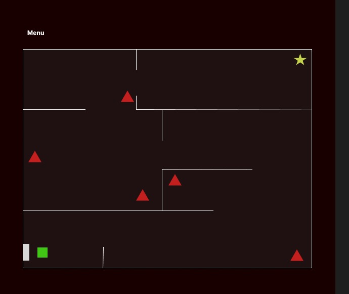

O jogo tem um menu com duas opções, start e exit. Quando o jogador escolhe "start" o jogo passa a estar em estado de jogo, onde cria a arena e o jogo em si. A arena é constituída por: paredes; guardas que rondam a arena numa tentativa de detetar o jogador (game over); um prize (o objetivo é adquiri-lo e fugir da arena com ele); uma porta de saída (que abre depois de o jogador adquirir o prize, para que possa fugir e ganhar o jogo); Thief (o playable character que, para além de poder ganhar o jogo apenas fugindo dos guardas, também pode optar por matá-los). Esta arena é desenhada a partir de um ficheiro que contém cada objeto representado por um caracter a sí específico.

Menu do jogo:
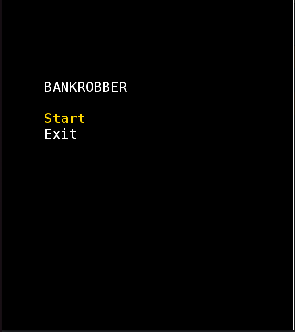

Arena antes de adquirir o prémio:
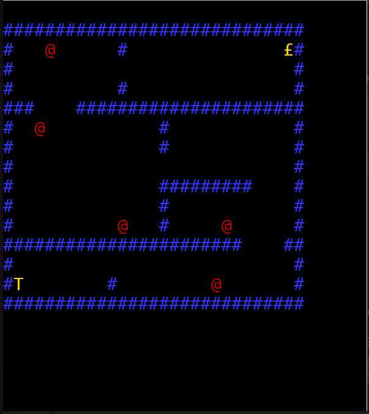

Arena depois de adquirir o prémio:
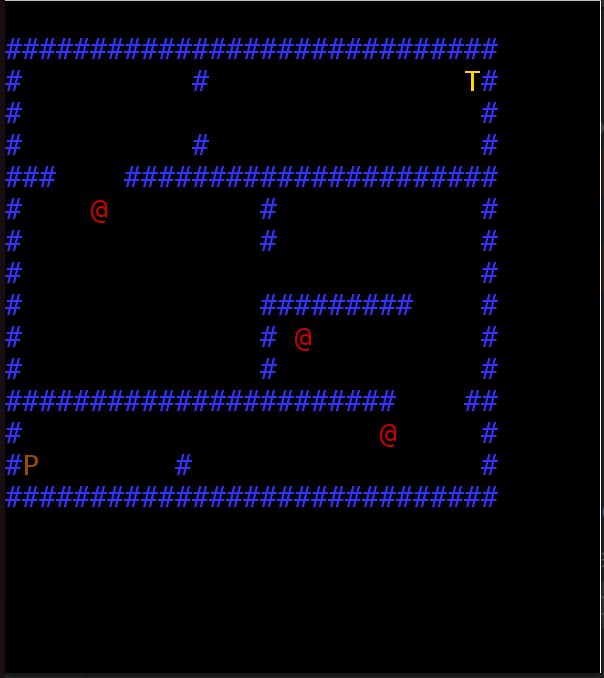

Ficheiro de crição de arena:G-Guarda,#-Parede,T-Ladrão, posteriormente Porta
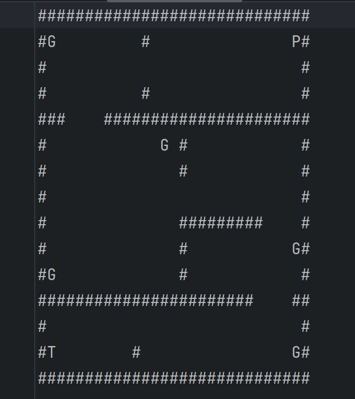

Queremos ainda acrescentar: câmeras (estáticas, móveis,etc); lazers (com timer); diferentes tipos de guardas (diferentes padrões de movimento/campos de visão); perseguição do jogador por parte dos guardas quando é detetado; itens de defesa para o jogador (ex:invisibilidade temporária); diferentes mapas; melhorar a aparência do mapa e personagens; uma função que diminui a velocidade do thief depois de apanhar o prize.

## Testes

Criamos diversos testes para verificar a qualidade do nosso código.Criamos assim os seguintes testes:

ThiefViewerTest:
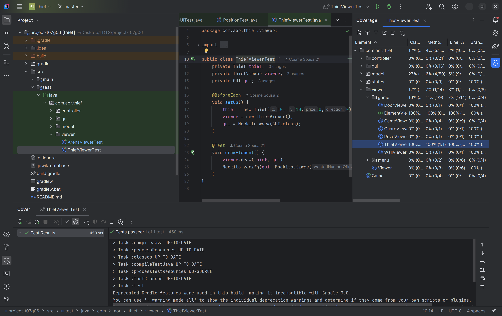

ArenaViewerTest:
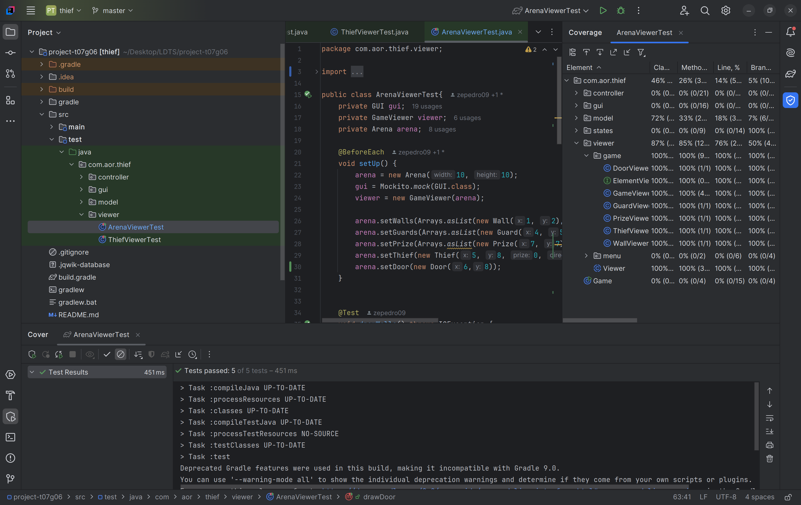

LanternaGUITest:
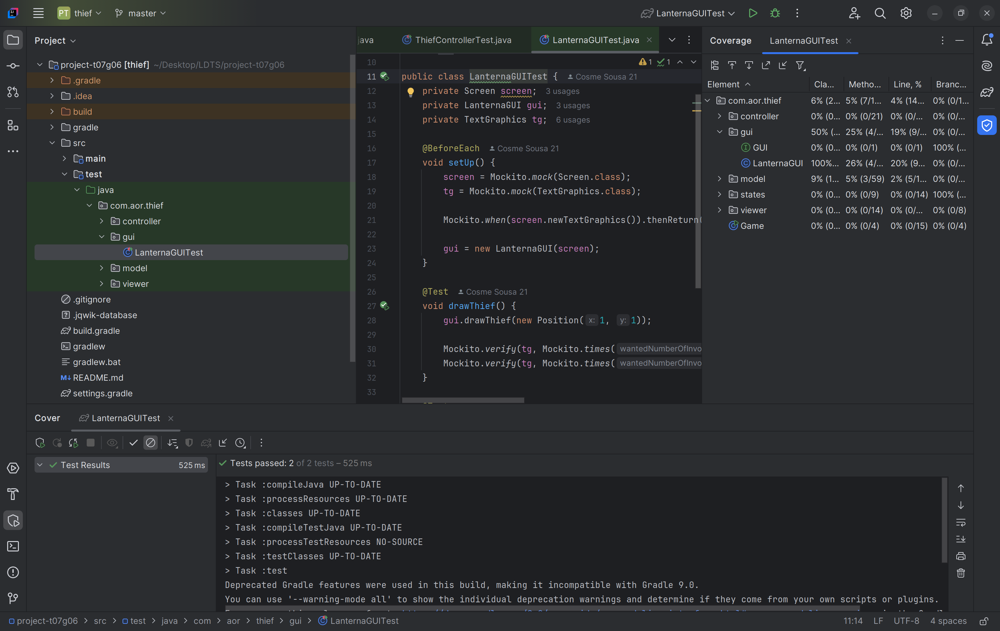

PositionTest:
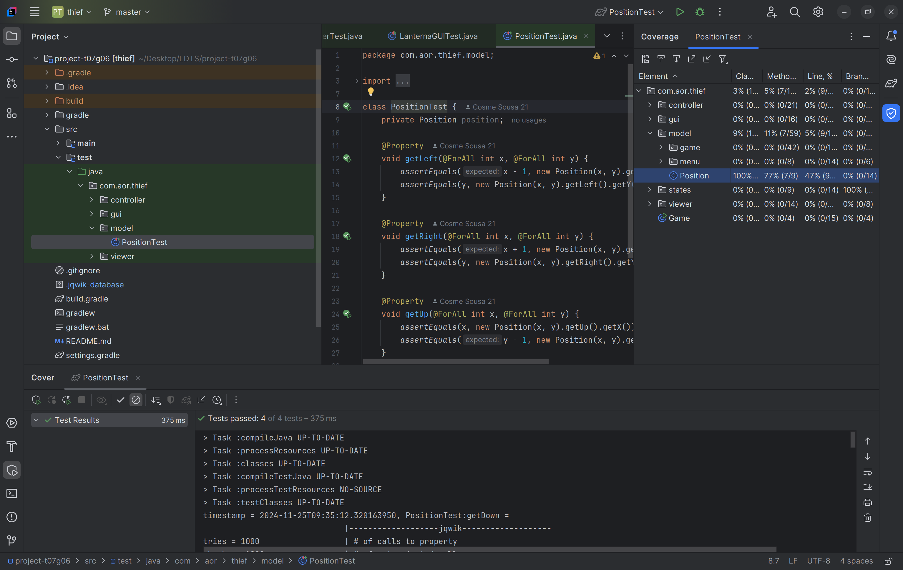

GuardControllerTest:
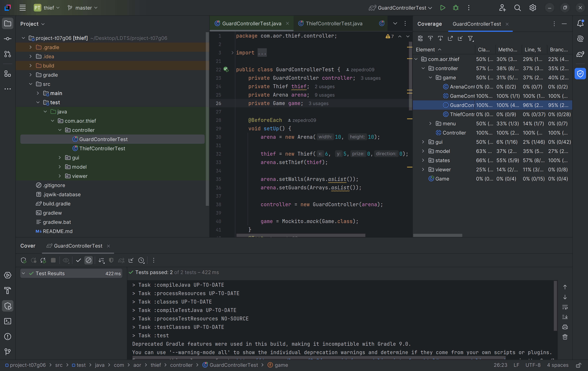

ThiefControllerTest:
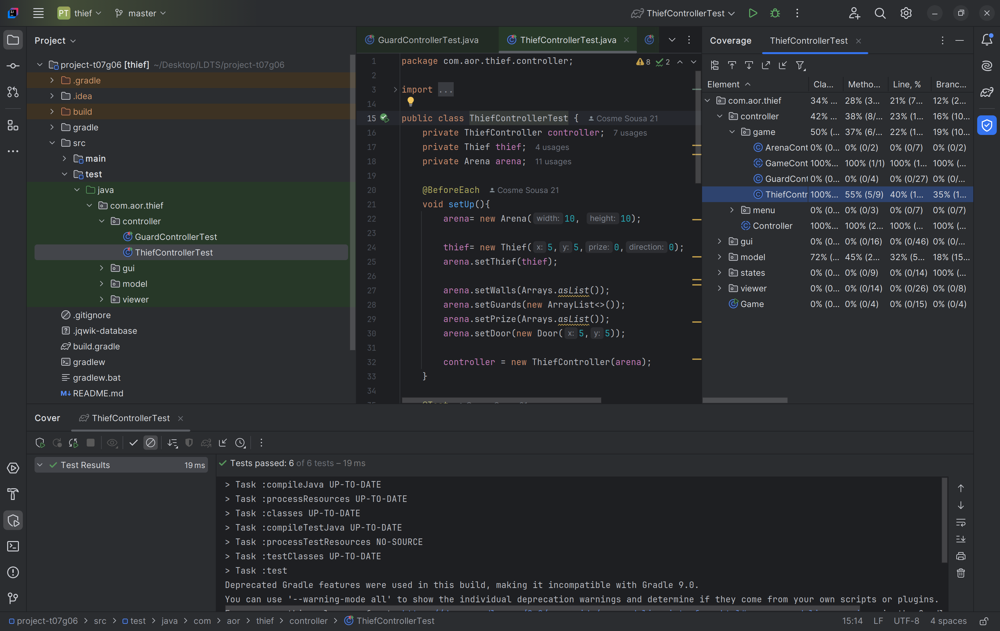

## Design Patterns

A UML abaixo representada, demonstra o design patterns no nosso projeto. Apesar de aplicarmos os princípios do SOLID como base para a estrutura do código, existem partes que podem não os seguir completamente. Isso acontece porque, neste momento, estamos focados em ter uma implementação funcional antes de refatorar e otimizar o código para seguir rigorosamente estes princípios. Este é um passo intencional no desenvolvimento para garantir que a lógica principal está operacional antes de fazer ajustes estruturais mais detalhados.

UML:
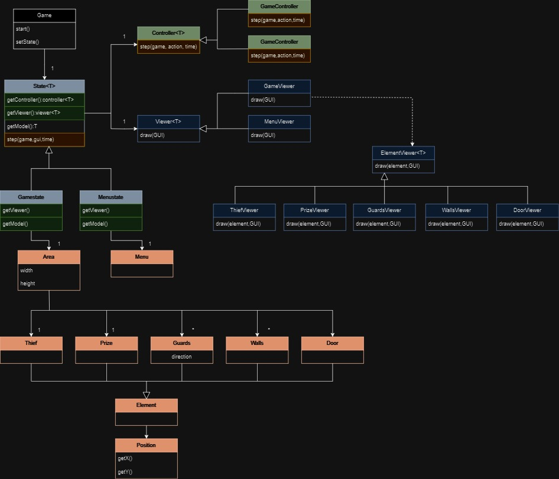

