# **BANKROBBER**

## Jogo

Em Bankrobber, o jogador assume o papel de um ladrão habilidoso, determinado a executar o roubo perfeito. O objetivo central é apoderar-se de um objeto valioso, que está localizado numa área protegida, repleta de obstáculos e inimigos. O jogador irá encontrar câmeras de vigilância, guardas e polícias que patrulham a área para impedir o jogador. Assim que o ladrão obtém o objeto desejado, uma porta de saída surge na sua localização inicial. A única sáida.

Para alcançar o sucesso, o jogador deve equilibrar elementos de estratégia e ação.
Os guardas e os polícias seguem atentos a qualquer movimento suspeito, enquanto as câmeras de segurança monitorizam áreas cruciais. Se o ladrão  entrar no campo de visão de um inimigo, os restantes oponentes são notificados da localização do ladrão e entram em modo de perseguição até capturá-lo.
No entanto, é possível completar o jogo sem ser visto, mas o jogador também tem a oportunidade de matar os guardas para escapar.

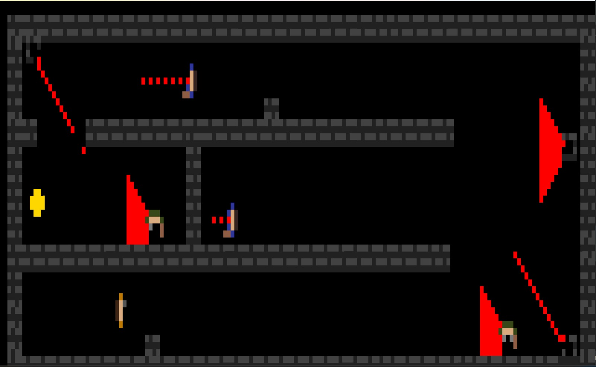

Controlos do jogo:

`setas ou wasd` : movimentar o jogador

`Q`: quit

`E`: entrar na porta

`Space`: disparar

## Features:

### Main Menu screen: 
Tela inicial do jogo que permite ao jogador escolher entre começar o jogo, ver as instruções ou sair do jogo.

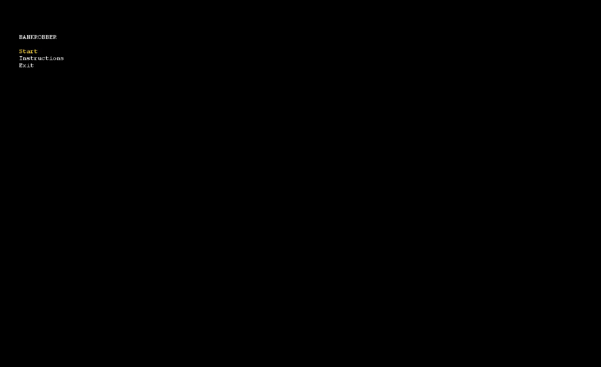

### Win screen: 
Aparece quando o jogador completa o jogo e permite-lhe escolher entre voltar ao menu ou recomeçar o jogo.

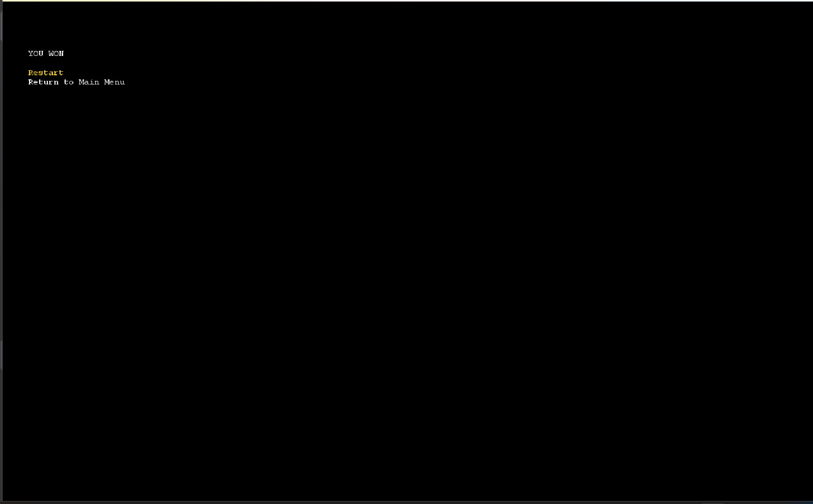

### Game Over screen:
Aparece quando o jogador é apanhado e permite-lhe escolher entre voltar ao menu principal ou recomeçar o jogo.

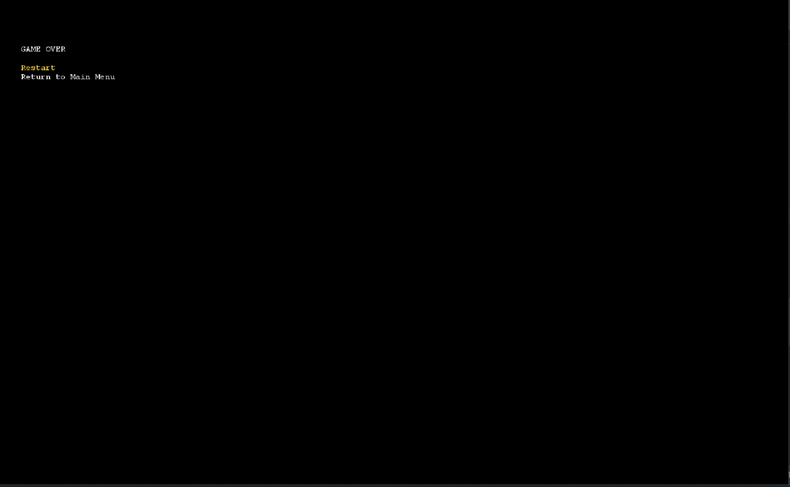

### Menu Instruções:
Tela que pode ser selecionada no main menu que informa o jogador dos controlos do jogo; permite ao jogador voltar ao menu principal ou começar o jogo diretamente.

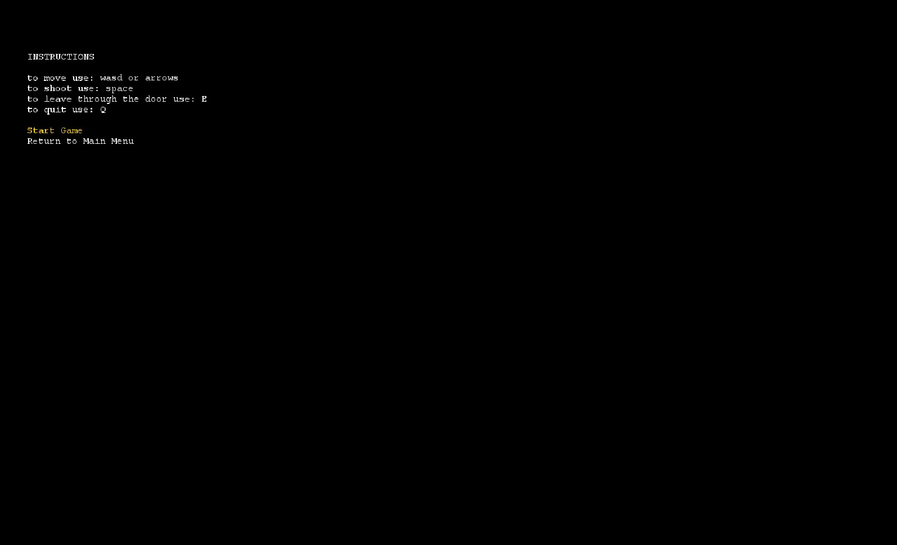

### Movimentação do ladrão:
O jogador pode mover o personagem nas setas ou com wasd.

Disparo:  o jogador pode matar os guardas ao disparar com a tecla space.

Câmeras:   há dois tipos de câmeras no jogo que podem revelar a localização do ladrão: estáticas (não movem o campo de visão) e rotativas (movem o campo de visão da esquerda para a direita, olhando também para o centro).

Inimigos - Guardas e Policias:   há dois tipos de guardas que podem apanhar o ladrão e localizá-lo: guardas (apenas andam pelos cantos das salas) e polícias (movem –se em zig zag podendo entrar em salas diferentes).

Collectible System:   o jogador coleta um item ao passar por cima dele, o que faz com que a porta de saída apareça.

Escape:   após coletar o item o ladrão pode dirigir-se a uma porta para fugir da arena e completar o jogo.

Pursuit:   ao ser visto por um dos inimigos ou câmeras, os inimigos são notificados do paradeiro do ladrão e perseguem-no pelo mapa.

### Explicação de algumas features

Para alcançar o efeito de visão em cone nós damos um valor de sight, que é o valor máximo que queremos que o elemento veja para a frente. A partir daí iniciamos o i de forma a percorrer as posições para a frente uma a uma.

Dentro desse loop iniciámos também uma variável j que vai fazer com que seja possível ver para os lados e para a frente.

A fórmula da visão em cone fica então j=2i+1

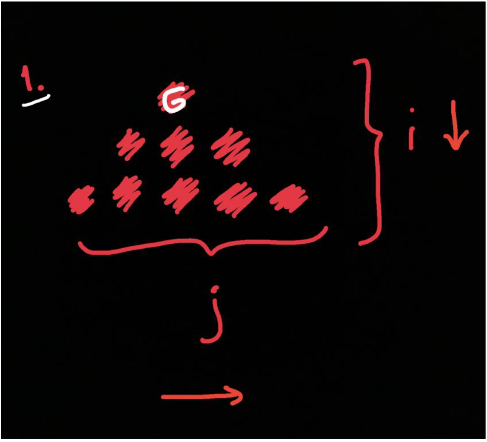

Para evirar que a visão em cone veja para lá das paredes, verificamos se o j está no meio ou não, se estiver no meio, apenas não se consegue ver o que estiver atrás da parede, mas se tiver num dos lados(esquerda/direita ou baixo/cima) deixa de conseguir ver para lá do j.

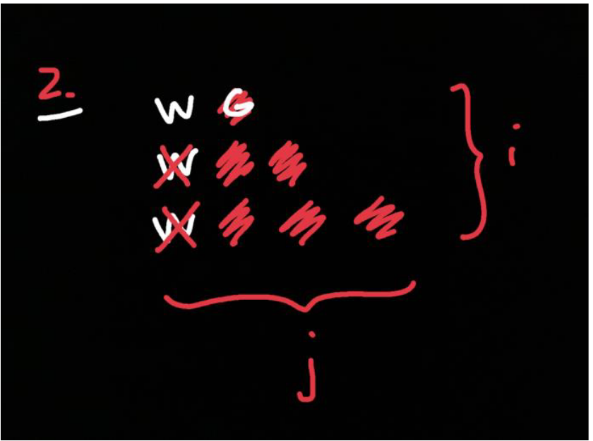

Para as câmeras ele vai definir o canto onde se encontra. Ao ver quais são as paredes que o rodeiam passa a saber as posições onde consegue ver (onde não tem parede). Depois de definido o canto em que a câmera se encontra, percorre-se o vetor corner que contem as direções para onde a câmera aponta. A posição do meio (diagonal) é a junção das duas outras posições (cima-2 esquerda-1, diagonal-12). Com a flag de isDown verifica-se se  está a subir ou a descer ao percorrer a lista, definindo assim a direção e visão naquele momento.

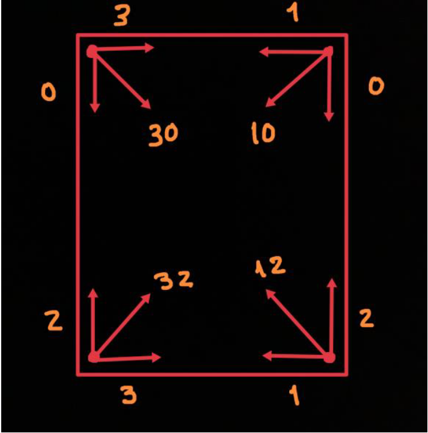

## Estrutura 

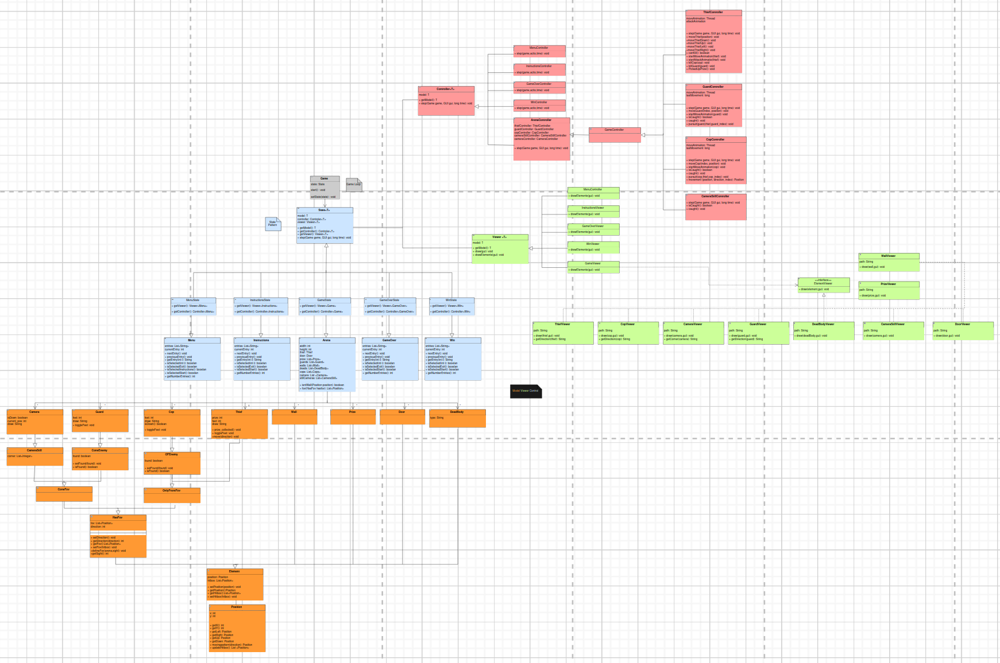

## Design Patterns 

### MVC(model-viewer-controller)
 
O padrão de desenho MVC, é utilizado como maneira de organizar o código e separar as responsabilidades de cada componente, permitindo assim ao código estar bem organizado separado em 3 partes essencias:

#### Modelo 
O Modelo trata dos dados, como, por exemplo, a posição do ladrão.  

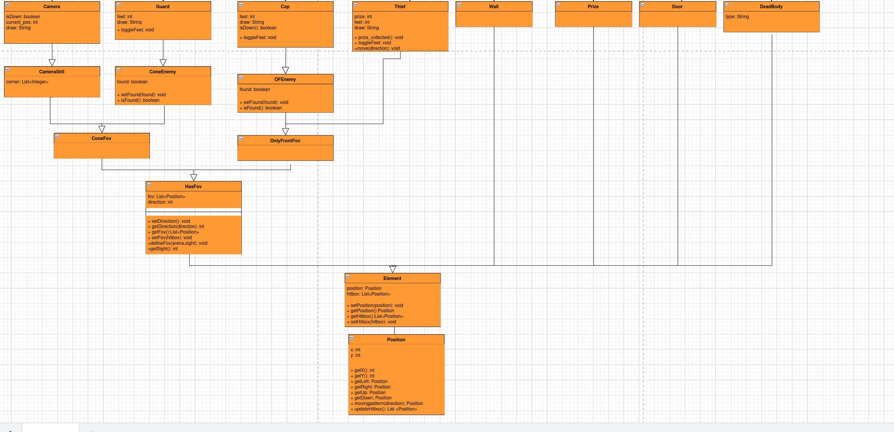

#### Viewer
O Viewer é responsável pela exibição de cada elemento do jogo no ecrã.

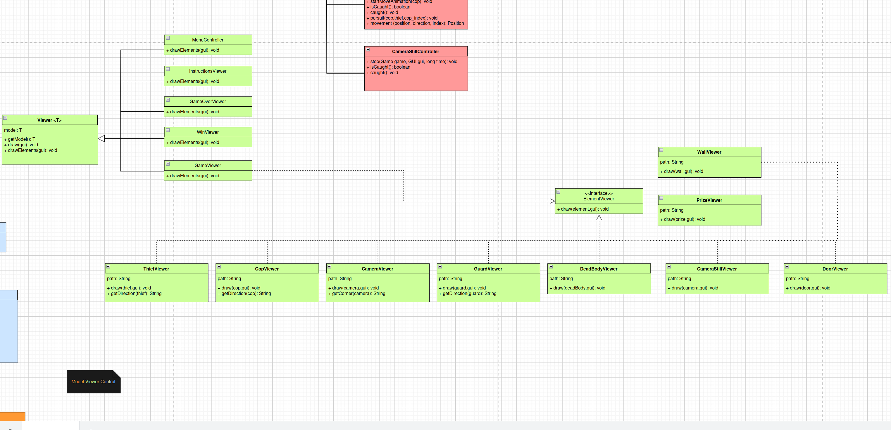

#### Controller
O Controller processa o input dado pelo jogador, servindo de intermediário entre o jogador e o modelo.

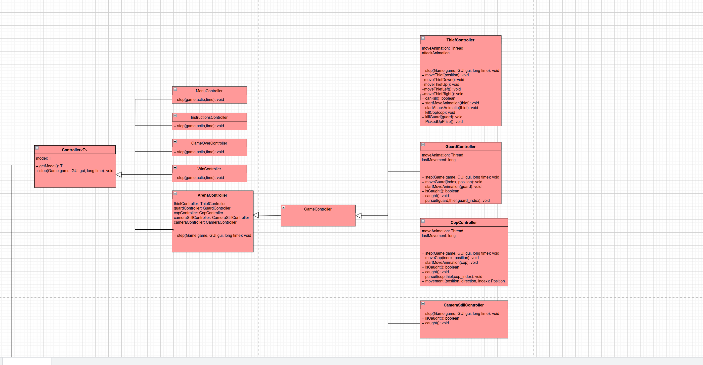

Este padrão é vantajoso porque promove a separação de responsabilidades, tornando cada parte do jogo independente, o que facilita significativamente a modificação de qualquer componente sem causar grandes impactos nos demais.

### State Pattern

Para lidar com os diferentes estados em que o jogo se pode encontrar (Game state, GameOver state, etc) usámos o state design pattern para podermos alterar o comportamento do jogo de acordo com o estado atual sem precisar usar if/else ou switches. O objeto principal mantém uma referência ao estado atual e atualiza o comportamento do jogo dependendo do estado em que se encontra. Cada um dos possíveis estados encontram-se em classes separadas que definem comportamentos específicos de cada estado.

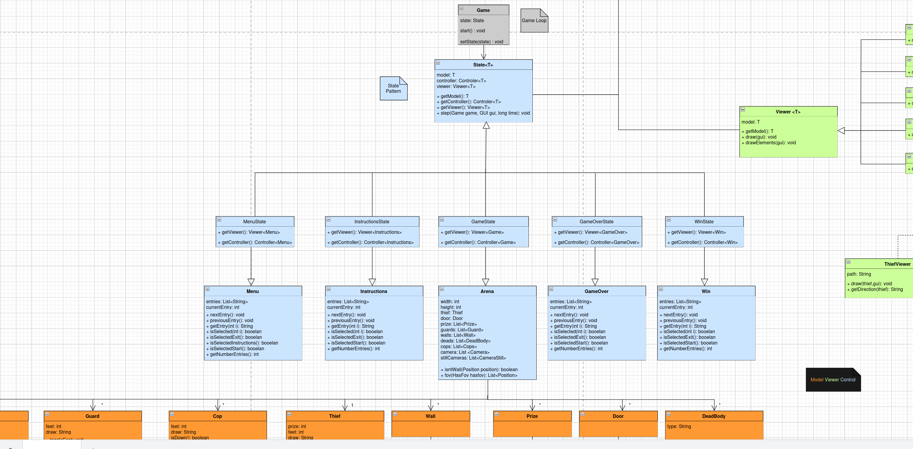

A utilização deste padrão é benéfica pois permite não só torna o código mais limpo, como também promove uma boa organização e extensibilidade.

### Factory Method

Para incorporar diferentes sons no jogo decidimos usar um factory method para apenas termos de recorrer a uma única classe (SoundFactory) para criar e gerir os sons.

Esta classe contém toda a lógica para carregar e criar diferentes sons o que permite evitar a duplicação de código ao instanciar sons.

A fábrica possui vários métodos como, por exemplo, createBackgroundSound(), createFootStepSound(), etc...que fornecem sons específicos como instâncias prontas de objetos LoopedSoundPlayer ou objetos InstanceSound para uso das classes Game e Thief. As classes que utilizam estes sons não precisam de saber como os sons são carregados/configurados, apenas usam a instância que a classe fornece.

O uso deste padrão promove uma boa organização do código pois centraliza a criação de sons. Para além disso, torna mais fácil acrescentar novos sons pois isso apenas exige alguns ajustes na fábrica.

### Game Loop

Na criação de jogos, é importante conseguir controlar a velocidade a que o jogo é processado, isto é: o movimento dos inimigos,a frequencia em que são processados os inputs ou as situações em que há a ausência destes e a que velocidade as imagens são atualizadas no ecrã

Para tal, é costume utilizar se o padrão de desenho Game Loop. Este padrão de desenho consiste na utilização de um ciclo while, que corre enquanto o jogador não saiu do jogo, juntamente com um valor de FPS, que são utilizados para determinar o numero de vezes que a imagem é atualizada por segundo. 

## Code smells

Duplicate code: em guard e cop controler ambos partilham um método pursuit ( método de perseguir o ladrão). Poderíamos criar uma interface por exemplo para deixar de haver este método duplicado mas para legibilidade e para facilitar a interpretação do código optamos por não o fazer mantendo assim em cada controler um pursuit.

## Bugs 
Bugs no desenho dos guardas/cops: por algum motivo que não conseguimos descobrir, apenas o 1o guarda e o 1o polícia é que são desenhados corretamente (quando se movem o desenho do personagem vira-se na direção do movimento) e os seguintes ficam congelados na imagem inicial embora se movam e a sua visão seja atualizada.

### Test coverage

Unit testing e mocks:

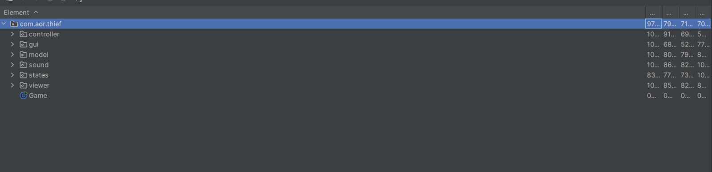

Pitest:

- Estatisticas

================================================================================

>> Line Coverage (for mutated classes only): 704/1257 (56%)

>> Generated 817 mutations Killed 297 (36%)

>> Mutations with no coverage 396. Test strength 71%

>> Ran 806 tests (0.99 tests per mutation) 

Nota:
Como os nossos controladores de cada um dos nossos teste utiliza bastantes switch cases e if statements a coverage é bastante afetada.

 

 

 

 

 

 

 

 

 